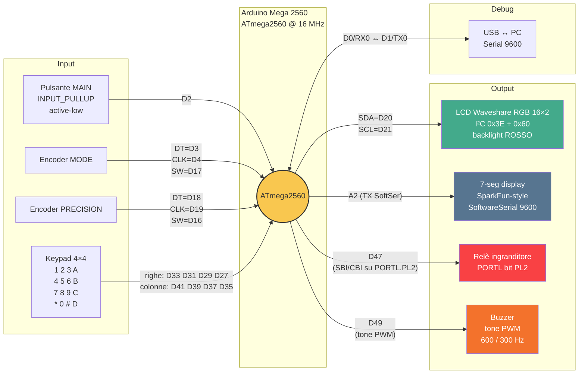
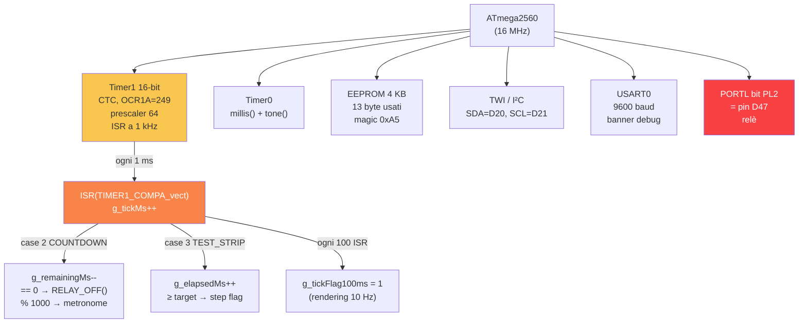
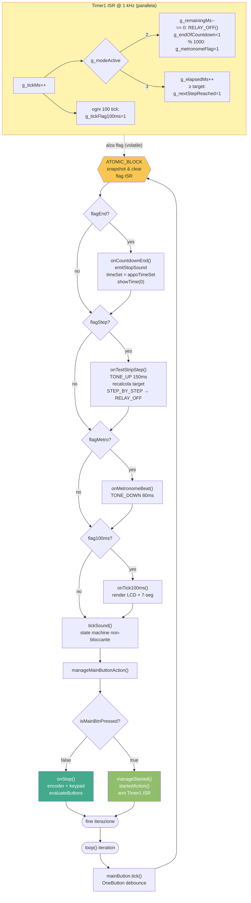
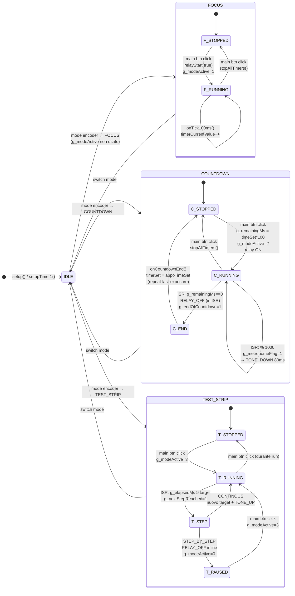
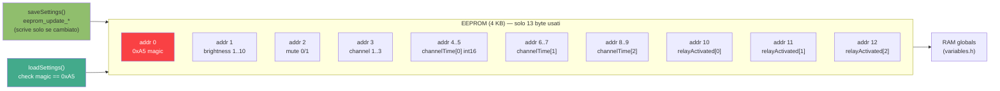
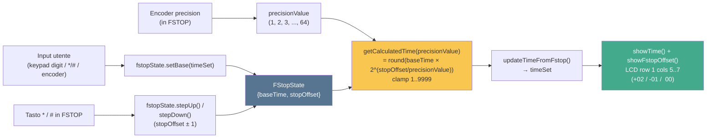
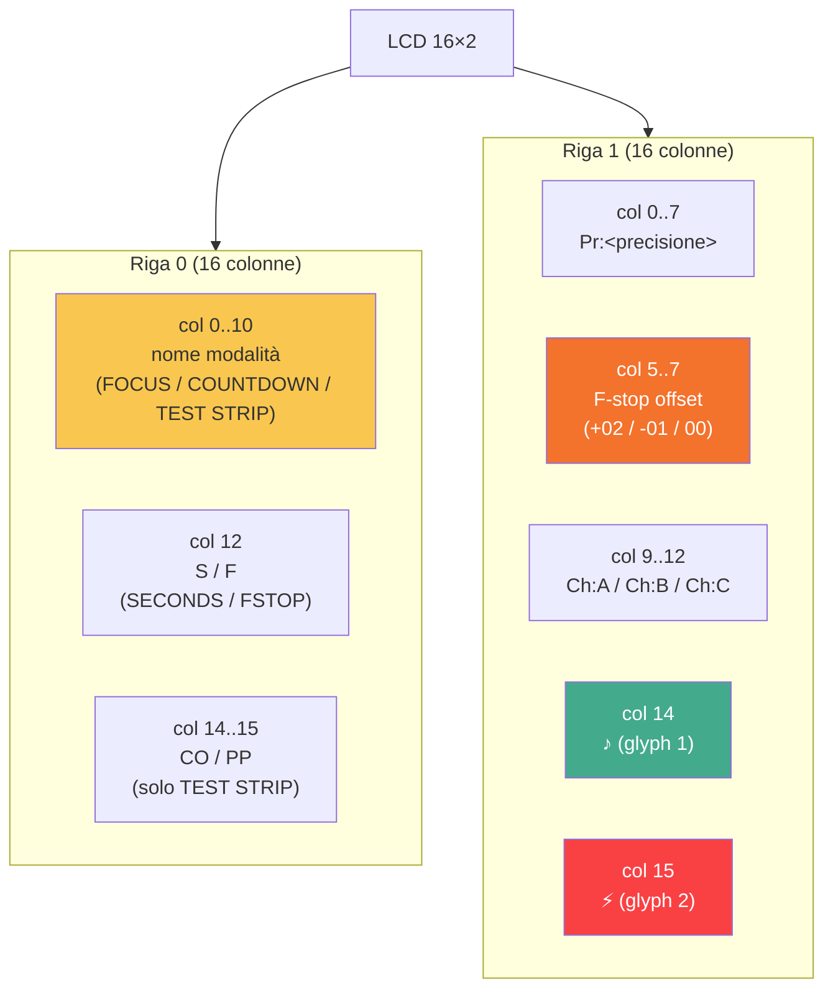
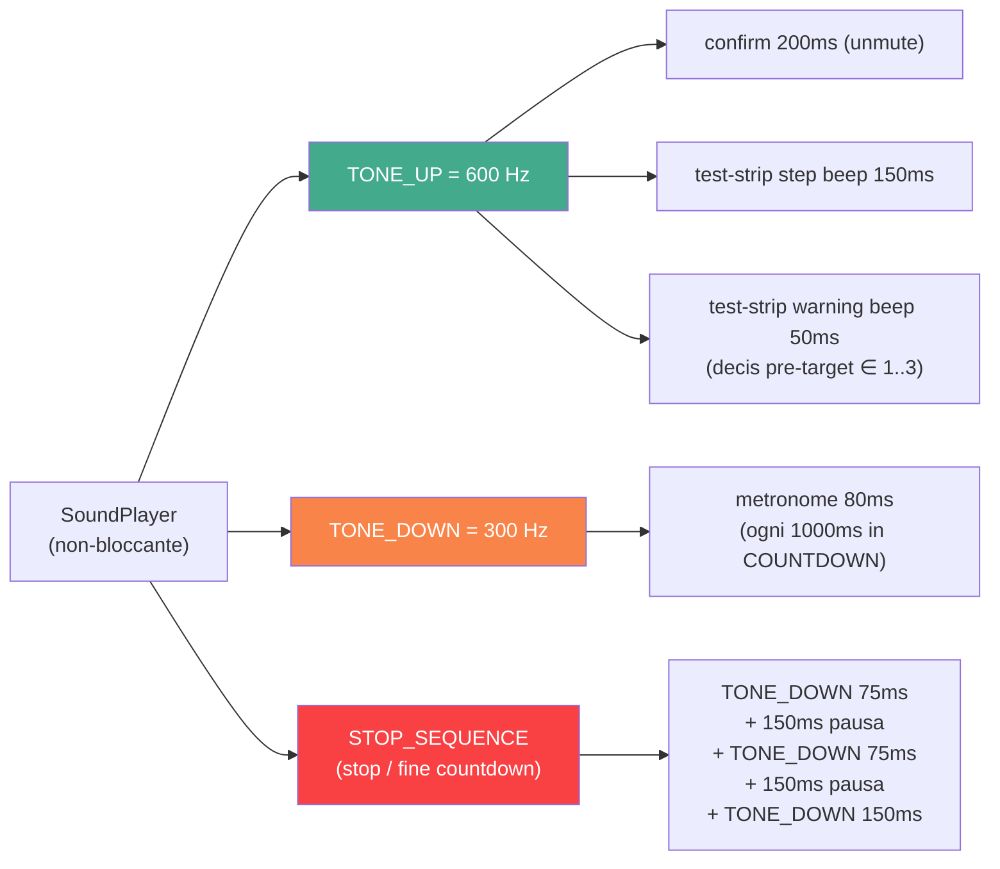

# DIAGRAMS — R080 Timer MEGA

Schemi Mermaid estratti direttamente dal codice (`include/constants.h`, `include/variables.h`, `include/functions/*.h`, `src/main.cpp`).

> Per visualizzare i diagrammi: aprire questo file in un viewer Markdown con supporto Mermaid (VS Code + estensione *Markdown Preview Mermaid Support*, GitHub, GitLab, Obsidian, ecc.).

---

## 1. Collegamenti hardware (vista a stella)

---

## 2. Risorse interne MCU

---

## 3. Main loop — flusso `loop()` + ISR

---

## 4. Stati delle modalità operative

---

## 5. Mappa dati EEPROM (13 byte, magic `0xA5`)

---

## 6. Pipeline F-Stop (precisione e calcolo tempo)

---

## 7. Layout LCD 16×2 — slot di rendering

---

## 8. Frequenze audio e sequenze

