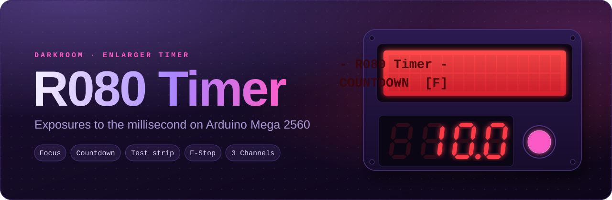

<p align="center">
  
</p>

<p align="center">
  <a href="https://github.com/DaniloCaruso/R080Timer_MEGA/actions/workflows/firmware.yml?query=branch%3Afeature%2Farduino-mega-firmware"></a>
  <a href="https://danilocaruso.github.io/R080Timer_MEGA/"></a>
  
  
  <a href="LICENSE"></a>
</p>

<p align="center">
  <b><a href="https://danilocaruso.github.io/R080Timer_MEGA/">Site</a></b> ·
  <a href="https://danilocaruso.github.io/R080Timer_MEGA/pinout.html">Pinout</a> ·
  <a href="https://danilocaruso.github.io/R080Timer_MEGA/funzioni.html">Features and controls</a> ·
  <a href="https://danilocaruso.github.io/R080Timer_MEGA/flussi.html">Flows</a> ·
  <a href="https://danilocaruso.github.io/R080Timer_MEGA/installazione.html">Setup</a> ·
  <a href="README-IT.md">Italiano</a>
</p>

Darkroom enlarger timer on Arduino Mega 2560: it decides how long the light exposes the paper. Firmware v2.1.0, written in C++ with PlatformIO and tested on the PC. The time is counted by Timer1, so the lamp turns off to the millisecond.

## What it does

| Modes | Precision | Safety |
|---|---|---|
| **Focus** with automatic shut-off | **Seconds** or **F-Stop**, from 1/1 to 1/64 of a stop | Lamp off at power-on and on every reset |
| **Countdown** with Metronome | Offset in stops always on the LCD | Watchdog: lamp off within 250 ms |
| **Test strip**, continuous or step-by-step | Clock correction in ppm | The timer keeps working even without the LCD |

| Channels | Darkroom lights and sounds | Service menu |
|---|---|---|
| `A`, `B`, `C`: each holds a complete print setting | LCD always red, 8 brightness levels for LCD and 7-segment | Counters, system health, a test for every component |
| Saved in EEPROM, restored at power-on | LCD dimmed during the Exposure | Clock calibration, factory reset, event log over USB |
| | Distinct sounds for start, Metronome, Pre-warning, Step, end; mute | LCD texts in **Italian or English** (`Lingua/Language`) |

## Hardware

Arduino Mega 2560, Waveshare 1602 RGB LCD (I²C), serial 7-segment display, 4x4 keypad, two rotary encoders with push button, main button, buzzer, relay module for the lamp.

| Component | Pin |
|---|---|
| LCD (I²C) | SDA D20, SCL D21 |
| 7-segment (display RX) | D14 (TX3) |
| Keypad rows / columns | D33, D31, D29, D27 / D41, D39, D37, D35 |
| Mode encoder DT / CLK / SW | D3 / D4 / D17 |
| Precision encoder DT / CLK / SW | D18 / D19 / D16 |
| Main button | D2 (to GND) |
| Buzzer | D49 |
| Lamp relay | D47, with a 10 kΩ resistor to GND |

Details in [PINOUT.md](PINOUT.md) (Italian).

**Upgrading.** From v1: move the 7-segment wire from A2 to D14 and add the 10 kΩ resistor between D47 and GND. From v1 or v2.0.0: at the first power-on the settings start from factory values (Italian language).

## Build and upload

You need [PlatformIO](https://platformio.org/) (VS Code extension or PlatformIO Core).

```
pio run                      # build for the Mega
pio run -t upload            # build and upload to the board
pio test -e native           # logic tests on the PC
pio device monitor -b 115200 # event log
```

Libraries (fetched by PlatformIO): [Encoder](https://github.com/PaulStoffregen/Encoder), [Keypad](https://github.com/Chris--A/Keypad), [OneButton](https://github.com/mathertel/OneButton). The LCD has its own driver.

After the first upload, calibrate the clock: see the manual, §11.

## Documentation

- [DOCS.md](DOCS.md): user manual ([Italian](DOCS-IT.md))
- [PINOUT.md](PINOUT.md): wiring and microcontroller resources (Italian)
- [TECNICO.md](TECNICO.md): firmware architecture (Italian)
- [CHANGELOG.md](CHANGELOG.md): versions (Italian)
- [GLOSSARY.md](GLOSSARY.md): project vocabulary (Italian)
- `docs/firmware-rewrite/`, `docs/ui-languages/`: v2 requirements and decisions
- `tools/calibrate.py`: clock calibration from a PC

## License

[Creative Commons Attribution-NonCommercial-ShareAlike 4.0 International](https://creativecommons.org/licenses/by-nc-sa/4.0/) (CC BY-NC-SA 4.0): you may share and adapt the project with attribution, not for commercial purposes, and under the same licence. Full text in [LICENSE](LICENSE).
