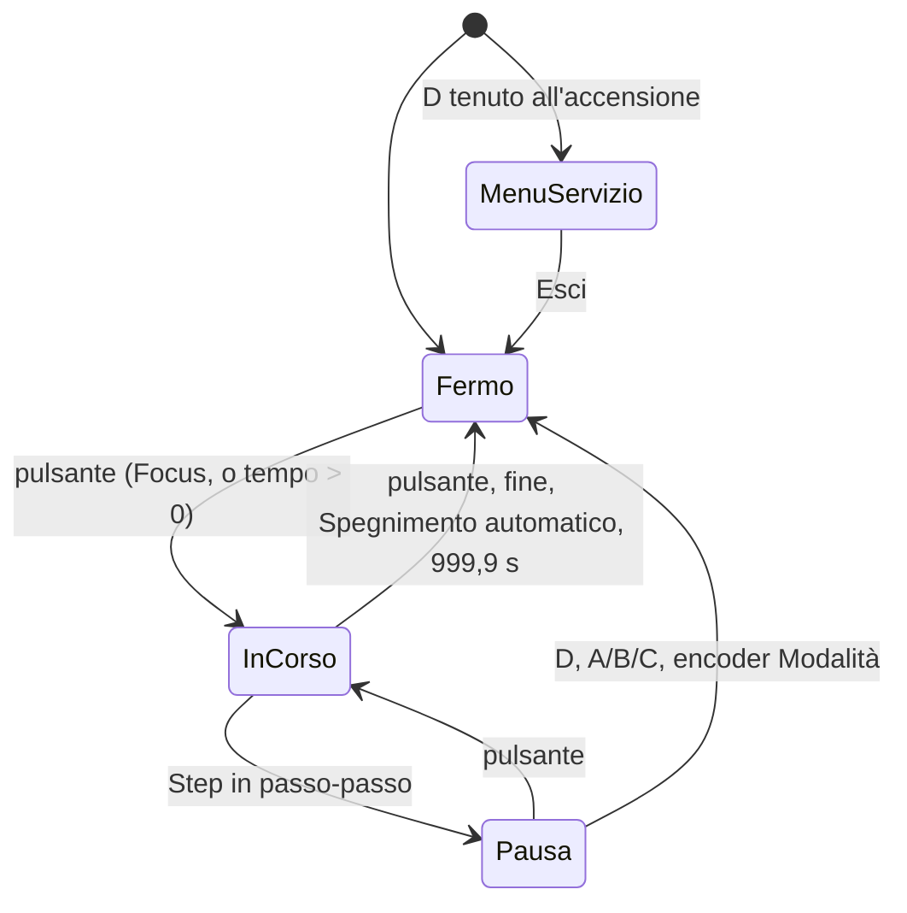

# TECNICO — Architettura del firmware R080 Timer v2.1.0

Documento per chi modifica il firmware. Comportamento utente in [DOCS-IT.md](DOCS-IT.md), collegamenti in [PINOUT.md](PINOUT.md), requisiti (REQ-x.y) in `docs/firmware-rewrite/requirements-docs/EARS.it.md` e, per le lingue dell'LCD, in `docs/ui-languages/requirements-docs/EARS.it.md`, decisioni in `docs/<feature>/decisions.md`, vocabolario in [GLOSSARY.md](GLOSSARY.md). Questo documento sostituisce i vecchi `TECNICO.md` e `DIAGRAMS.md`, che descrivevano il firmware v1 (consultabile al tag `pre-rewrite`).

## 1. Strati

| Strato | Cartella | Contenuto |
|---|---|---|
| Dominio | `lib/r080_core/` | C++17 puro, senza header Arduino né AVR (la CI lo verifica). Parla con l'hardware solo tramite le interfacce di `Hal.h`. Testato sul PC. |
| Driver | `src/drivers/` | Implementazioni sottili delle interfacce: Timer1 e relè, LCD, 7 segmenti, buzzer, EEPROM, input, watchdog, log USB. |
| Composizione | `src/main.cpp` | Crea gli oggetti, li collega e fa girare il loop. |

### Moduli del dominio

| File | Ruolo |
|---|---|
| `Hal.h` | `enum class Input`, struttura `Health`; interfacce `SevenSeg`, `Lcd`, `Buzzer`, `Storage`, `EventLog` (con `print()` da un formato in flash), `TimingPort`; `LEVEL_COUNT = 8` livelli di luminosità |
| `Flash.h` | Testi costanti in flash: `PROGMEM`, `FSTR`, `fmemcpy`, `fsnprintf` (funzioni `_P` su AVR, normali sul PC) |
| `TimeUnits.h` | ms `uint32_t` all'interno, decimi di secondo all'interfaccia (`DS_MIN = 1`, `DS_MAX = 9999`) |
| `TimingCore.h` | Logica di un tick della ISR, tutta inline |
| `ClockCorrection.{h,cpp}` | Accumulatore in ppm per tick; calcolo della correzione da una misura |
| `Precision.h` | Liste di precisione e `fstopTime()` (float, solo nel loop) |
| `Controller.{h,cpp}` | Macchina a stati dell'interfaccia: input, comandi al `TimingCore`, 7 segmenti, suoni, log, contatori |
| `Screen.{h,cpp}` | Immagine dell'LCD e invio delle sole differenze |
| `Texts.{h,cpp}` | Testi dell'LCD in italiano e inglese in una tabella in flash, con le colonne disponibili di ciascuno; `text(id, lingua)` |
| `SoundScheduler.{h,cpp}` | Tabella dei suoni e sequenze senza attese |
| `Settings.{h,cpp}`, `Crc8.h` | Canali e impostazioni globali in EEPROM; CRC8 e scrittura a passi dei blocchi |
| `Counters.{h,cpp}` | Contatori persistenti per la diagnostica |
| `ServiceMenu.{h,cpp}` | Menu di servizio, test hardware, calibrazione |

### Driver

| File | Interfaccia | Note |
|---|---|---|
| `Timer1Clock` | `TimingPort` | Timer1 CTC 1 kHz, ISR, relè su PORTL, misure con Timer4 |
| `LcdWaveshare` | `Lcd` | I²C a 100 kHz, timeout 3 ms, inizializzazione a passi, nuovo tentativo ogni 2 s |
| `SevenSegSerial3` | `SevenSeg` | Serial3 a 9600 baud, buffer hardware di 64 byte |
| `BuzzerTone` | `Buzzer` | `tone()` su D49 (Timer2) |
| `EepromStorage` | `Storage` | `eeprom_read_block` / `eeprom_update_block` / `eeprom_is_ready` |
| `UsbLog` | `EventLog` | Serial a 115200, scrive solo se la riga entra nel buffer |
| `InputDevices` | — | Keypad, Encoder, OneButton → `Controller::onInput()` |
| `SystemGuard` | — | Watchdog, marcatore del reset da watchdog |
| `Pins.h` | — | Pin e macro `RELAY_ON()` / `RELAY_OFF()` |

## 2. Avvio e loop

`setup()`, in quest'ordine:

1. `Timer1Clock::begin()`: relè spento e in uscita, Timer1 e Timer4 avviati.
2. `SystemGuard::begin()`: watchdog attivo; dice se l'avvio viene da un reset da watchdog. Da qui `setup()` deve finire entro 250 ms.
3. `InputDevices::keyDHeld()`: `D` premuto apre il Menu di servizio.
4. `Settings::load()`, `Counters::boot()`, messaggio `RESET: WDT` se serve.
5. Log USB, `Controller::boot()` (righe `BOOT` ed eventuale `ERROR settings=factory`), 7 segmenti, LCD, input.

`loop()` non contiene attese: `wdt_reset()`, `inputs.poll()`, `controller.update()`, `sound.tick()`, `screen.render()`, `settings.service()`, `timing.measure()`, e la durata del giro va in `Health::loopMaxUs`.

## 3. Motore temporale

**Timer1** in CTC, prescaler 64, `OCR1A = 249`: un interrupt ogni 1 ms. La ISR chiama `TimingCore::tick()`, accumula gli eventi, spegne il relè se il tick lo chiede, conta i tick e registra la propria durata (`TCNT1L` all'uscita, in conteggi da 4 µs). Niente divisioni né chiamate non inline.

**TimingCore** ha cinque stati (`Idle`, `Focus`, `Countdown`, `StripContinuous`, `StripStepped`) e produce eventi a bit:

| Evento | Quando | Relè spento nello stesso tick |
|---|---|---|
| `EV_END` | Fine del Countdown; test strip a 999,9 s | sì |
| `EV_METRONOME` | Ogni 1000 ms dall'inizio del Countdown (contatore a 16 bit, niente modulo) | no |
| `EV_STEP` | Tempo cumulativo del test strip al prossimo Step | solo in passo-passo |
| `EV_PREWARN` | 300, 200 e 100 ms prima dello Step | no |
| `EV_FOCUS_WARN` | 10 s prima del tempo massimo del Focus | no |
| `EV_FOCUS_OFF` | Tempo massimo del Focus | sì |

I bordi dipendono solo dal contatore della ISR: relè e tempo non dipendono mai dal loop o dai display. Il loop raccoglie gli eventi con `takeEvents()` e decide suoni, log e display.

**Test strip.** Il core conosce solo il prossimo Step (`setNextStep()`), che il `Controller` calcola in float nel loop, sempre dal Tempo base: `T + k·P` in Secondi, `fstopTime(base, offset + k, p)` in F-Stop. Uno Step uguale al precedente diventa precedente + 0,1 s. In passo-passo il core va in `Idle` allo Step; la ripresa chiama `startStrip()` dal tempo già trascorso.

**Correzione del clock.** `ClockCorrection::step()` somma i ppm a un accumulatore a ogni tick e dice quanti ms contare: 1 di norma, 2 o 0 quando l'accumulatore supera ±10⁶. Ogni ms passa dalle stesse regole, quindi nessun bordo viene saltato o ripetuto. Limite ±1000 ppm.

**Salute.** Timer4 conta libero con lo stesso prescaler di Timer1. `Timer1Clock::measure()` confronta ogni secondo i tick attesi con quelli contati dalla ISR; lo scarto oltre un tick va in `Health::lostTicks`.

**Atomicità.** Ogni accesso dal main allo stato condiviso con la ISR sta in `ATOMIC_BLOCK(ATOMIC_RESTORESTATE)`, comprese le scritture su PORTL: `tone()` scrive PL0 dalla sua ISR sullo stesso registro del relè (PL2).

## 4. Controller

- **Fermo:** cifre, `*`/`#`, encoder e Canali modificano il Canale attivo (`Settings::active()`). Il pulsante con tempo zero (Countdown, Test strip) dà il suono di errore.
- **InCorso** (`TimingPort::running()`): conta solo il pulsante principale, che annulla.
- **Pausa** (`paused_`): il pulsante riprende; `D` conclude la prova; `A`/`B`/`C` e la rotazione dell'encoder della Modalità la concludono e poi eseguono la propria azione (cambio di Canale o di Modalità); il resto è ignorato.
- **MenuServizio:** tutti gli input vanno a `ServiceMenu`; nessuna Esposizione.

`Controller::onInput()` chiama prima `update()`, così uno Step appena scattato mette già in pausa. A ogni avvio le impostazioni si salvano subito (`Settings::save()`), e il log riceve `START`; a ogni fine o Annullamento `END`/`CANCEL` con la durata misurata dalla ISR, e i contatori si aggiornano.

**Input** (`InputDevices`). Pulsanti con OneButton e antirimbalzo 20 ms: il principale agisce alla pressione (`attachPress`), quelli degli encoder al clic. Encoder letti come variazioni relative, una tacca ogni 4 conteggi. Tastierino letto con `getKeys()` per vedere più tasti insieme:

- `*` e `#` agiscono al rilascio, solo se non è scattato l'HOLD (1000 ms); rilasciati con `0` premuto danno le combinazioni `0`+`*` / `0`+`#`.
- `0` agisce al rilascio, se non è stato usato in una combinazione; un'altra cifra premuta mentre `0` è giù fa entrare prima lo `0`.

**7 segmenti.** Il valore mostrato si sceglie in `update()` (tempo impostato, residuo arrotondato per eccesso, trascorso, cumulativo, prossimo Step, `8888` nel test) e si invia solo quando cambia.

## 5. LCD

`Screen::compose()` costruisce l'immagine voluta (2 × 16 caratteri): splash per 1,5 s (o `RESET: WDT` per 3 s), Menu di servizio, oppure la disposizione normale (riga 1: Modalità alle colonne 0–10, tipo di precisione alla 12, Avanzamento alle 14–15; riga 2: precisione alle colonne 0–3 senza prefisso (` 5s`, `20s`, `1/3`, `1/12`), Offset alle 4–6, oppure `St:n` durante il test strip; `Ch:` e Canale alle 9–12, nota alla 14, spina alla 15). `render()` confronta con l'immagine già inviata e manda solo il tratto cambiato, al massimo una riga per giro di loop, in una sola transazione I²C.

`LcdWaveshare` inizializza a passi temporizzati senza `delay()` (function set ripetuto, display acceso e clear, entry mode, due caratteri personalizzati in CGRAM, PCA9633 con il solo rosso). Un errore I²C (anche il timeout di 3 ms) mette il driver offline e lo ritenta dopo 2 s; `Screen` registra `LCD offline` / `LCD online` e ridisegna tutto al ritorno.

Livelli di luminosità 1–8 (REQ-7.11):

| Livello | 1 | 2 | 3 | 4 | 5 | 6 | 7 | 8 |
|---|---|---|---|---|---|---|---|---|
| LCD, rosso PCA9633 | 4 | 8 | 16 | 28 | 48 | 80 | 140 | 255 |
| 7 segmenti, comando `0x7A` | 2 | 5 | 10 | 20 | 40 | 80 | 150 | 255 |

Durante un'Esposizione `Controller::lcdLevel()` restituisce il livello "LCD esposizione".

## 6. Suoni

`SoundScheduler` suona sequenze di note da una sola tabella (`SoundScheduler.cpp`), avanzando nel loop senza attese; `tone()` ferma da sé ogni nota. Una sequenza nuova interrompe quella in corso solo se ha priorità maggiore o uguale. Priorità dalla più alta: fine, errore, avviso Focus, avvio, step, preavviso, metronomo, conferma.

| Suono | Note (Hz/ms; 0 = pausa) |
|---|---|
| Fine | 600/150, 0/80, 450/150, 0/80, 300/150 |
| Errore | 150/300 |
| Avviso Focus | 450/200, 0/100, 450/200 |
| Avvio | 1000/60 |
| Step | 600/150 |
| Preavviso | 800/30 (uno per evento, tre eventi) |
| Metronomo | 300/80 |
| Conferma | 1200/40 |

Con il mute `Controller::beep()` lascia passare solo il Suono di fine: la conferma del mute passa da lì dopo il cambio, quindi suona solo spegnendolo. I suoni del Menu di servizio chiamano `SoundScheduler::play()` direttamente.

## 7. Persistenza

Due blocchi indipendenti, ognuno con intestazione, versione e CRC8 (polinomio 0x07). Un blocco non valido non si migra: le impostazioni tornano ai valori di fabbrica (riga `ERROR settings=factory`), i contatori a zero. Il formato v1 (`0xA5` all'indirizzo 0) non passa il controllo.

**Impostazioni**, indirizzo `0x000`, 45 byte:

| Offset | Byte | Contenuto |
|---|---|---|
| 0 | 4 | `'R'`, `'8'`, versione 2, lunghezza 45 |
| 4 | 10 | `GlobalRecord`: Canale attivo, mute, livello LCD, livello 7 segmenti, livello LCD in esposizione, indice del tempo massimo Focus, lingua (`Language`), byte riservato (0, tiene la Correzione del clock a un offset pari: stesso layout sull'AVR e sul PC), Correzione del clock (`int16_t`, ppm) |
| 14 | 30 | 3 × `ChannelRecord` (10 byte): Modalità, tipo di precisione, indice di precisione, Avanzamento, tempo (`uint16_t`, ds), Tempo base (`uint16_t`, ds), Offset (`int8_t`), Abilitazione relè |
| 44 | 1 | CRC8 dei 44 byte precedenti |

Oltre al CRC, `load()` controlla che indici e valori siano nei limiti (Correzione del clock ±1000 ppm, Offset ±99, tempo e Tempo base fino a 999,9 s). Una lingua sconosciuta diventa l'italiano senza scartare il resto. Il blocco della versione 1 (v2.0.0, 43 byte) non passa il controllo. Il salvataggio parte 2 s dopo l'ultima modifica (`Settings::changed()`) o subito all'avvio di un'Esposizione, e scrive solo i byte diversi da quelli in EEPROM, uno per giro di loop quando la EEPROM è pronta (`writeBlockStep()` in `Crc8.h`), il CRC per ultimo: un salvataggio interrotto lascia il blocco non valido e al riavvio valgono i valori di fabbrica.

**Contatori**, indirizzo `0x040`, 17 byte: `'R'`, `'C'`, versione 1, lunghezza 17 | accensioni (`uint16_t`, ogni avvio, compresi i reset da watchdog), reset da watchdog (`uint16_t`), Esposizioni (`uint32_t`), secondi di lampada (`uint32_t`) | CRC8. Salvati all'avvio, in `setup()`, e dopo ogni fine o Annullamento di Esposizione un byte per giro di loop (`Counters::service()`), come le impostazioni. Countdown e test strip contano come Esposizione anche se annullati; il Focus no. Il tempo a relè acceso, Focus compreso, conta nei secondi di lampada.

## 8. Sicurezza

- **Relè all'avvio:** `Timer1Clock::begin()` lo spegne per primo; prima di `setup()` lo tiene spento la resistenza da 10 kΩ su D47.
- **Watchdog** (`SystemGuard`): modalità interrupt + reset, 250 ms. Al primo timeout la ISR del watchdog spegne il relè, scrive un marcatore in RAM `.noinit` e attende; al secondo (500 ms) la scheda si resetta. All'avvio il marcatore dice se il reset viene dal watchdog, perché il bootloader azzera `MCUSR`. Una funzione in `.init3` spegne il watchdog prima di `init()` per l'avvio senza bootloader.
- **Brown-out:** soglia di fabbrica dei fuse, 2,7 V. La soglia a 4,3 V è nel backlog.
- **Esposizione interrotta:** nessuno stato di esposizione è salvato, quindi non può riprendere.

## 9. Menu di servizio e calibrazione

`ServiceMenu` ha 16 voci (vedi il manuale, §10), con i testi presi da `Texts` nella lingua salvata, e tiene in `hw_` lo stato del test in corso. Il Ripristino di fabbrica chiede una seconda pressione di conferma. Durante un test hardware il `Controller` applica `relayOn()` al relè con `TimingPort::setRelay()` e mostra `8888` se `sevenSegTest()`.

**Log di calibrazione.** A log attivo il `Controller` scrive ogni 1000 tick una riga `CAL ms=<tick>`, con i tick di Timer1 contati senza correzione. `tools/calibrate.py` registra per ogni riga l'istante del PC (`time.monotonic_ns()`), stima la pendenza con una regressione lineare (che assorbe il ritardo variabile della USB) e stampa `(pendenza − 1) · 10⁶` ppm: la correzione assoluta. `--self-test` verifica la stima su log sintetici da −1000 a +1000 ppm. La porta si apre con DTR e RTS bassi per non riavviare il Mega.

**Durata misurata.** Da un Countdown di 600,0 s misurato in `measured` ms con la correzione corrente `cur`: nuova correzione = `(10⁶ + cur) · measured / 600000 − 10⁶`, arrotondata e limitata a ±1000 ppm (`ppmFromMeasurement()`).

## 10. Log USB

115200 baud, una riga per evento: `t=<millis> <evento>`. `UsbLog::line()` scrive solo se la riga entra nel buffer di trasmissione; le righe scartate si contano e si segnalano con `LOST lines=n` appena c'è posto. Eventi: `BOOT reset=POWER|WDT`, `ERROR settings=factory`, `START mode=FO|CD|TS ch=A|B|C ms=<durata>`, `END|CANCEL ms=<chiesta> measured=<misurata>`, `LCD offline`, `LCD online`, `CAL ms=<tick>`.

## 11. Test, CI e rilascio

`pio test -e native` esegue i test Unity sul PC, sulle due seam del TECHNICAL:

| Cartella | Cosa prova |
|---|---|
| `test/test_timer/` | Dominio intero (`Controller`, `Screen`, `ServiceMenu`, `Settings`, `Counters`, `SoundScheduler`) con il `TimingCore` vero e driver finti (`test/fakes/`), comandato da input e tempo simulato |
| `test/test_timing_core/` | `TimingCore` da solo, tick per tick: bordi al millisecondo e Correzione del clock |
| `test/test_time/` | Unità di tempo |

La CI (`.github/workflows/firmware.yml`) a ogni push verifica che `lib/r080_core/` non includa header Arduino o AVR, compila per il Mega ed esegue i test native. Driver e misure reali si verificano sulla scheda con la Checklist di collaudo.

La versione è `FW_VERSION` in `platformio.ini` (mostrata all'avvio e in Info). Ogni versione va in [CHANGELOG.md](CHANGELOG.md); il rilascio è un tag `vX.Y.Z` sul commit collaudato.

## 12. Risorse e limiti noti

Build v2.1.0: RAM 1629 byte su 8192 (20 %), Flash 30070 byte su 253952 (12 %); la tabella dei testi in due lingue (`Texts`) sta tutta in flash.

- Testi dell'LCD, formati e righe del log stanno in flash (`Flash.h`); in RAM restano solo la tabella dei suoni, le piccole tabelle numeriche, versione e data di compilazione.
- Il 7 segmenti ha quattro cifre: un Focus oltre 999,9 s (possibile con il limite di 20 minuti) passa a minuti.secondi (`SevenSeg::showMinSec()`, punto dopo la seconda cifra).
